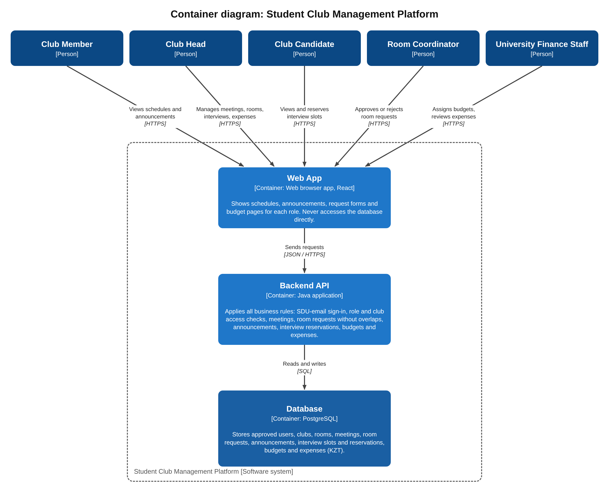

# Container Diagram

The `.drawio` file is the editable version of the diagram.

Our system has 3 containers:

- **Web App** (React): the pages that users see.
- **Backend API** (Java): all the rules, for example checking roles and stopping two people from booking the same slot.
- **Database** (PostgreSQL): stores all the data.

Users only talk to the Web App. The Web App talks to the Backend API,
and only the Backend API uses the Database.

There are no external systems, because in Milestone 1 we decided not to
connect to university, bank, email or calendar systems.

